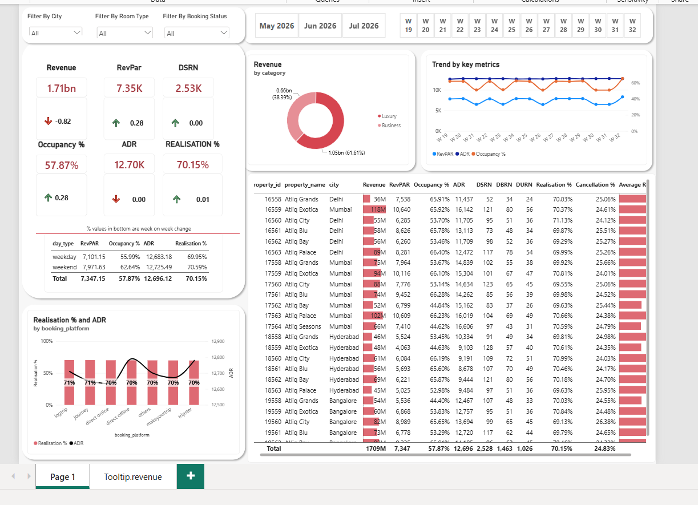
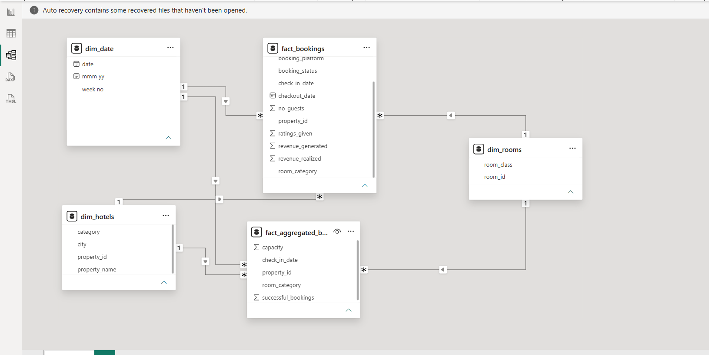
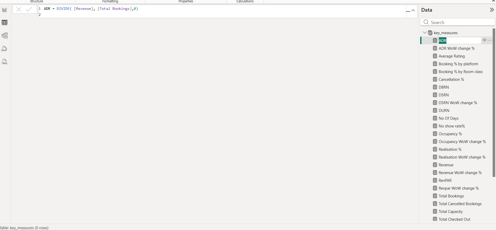
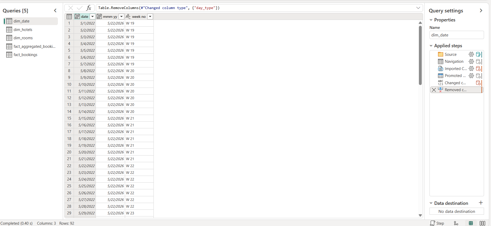
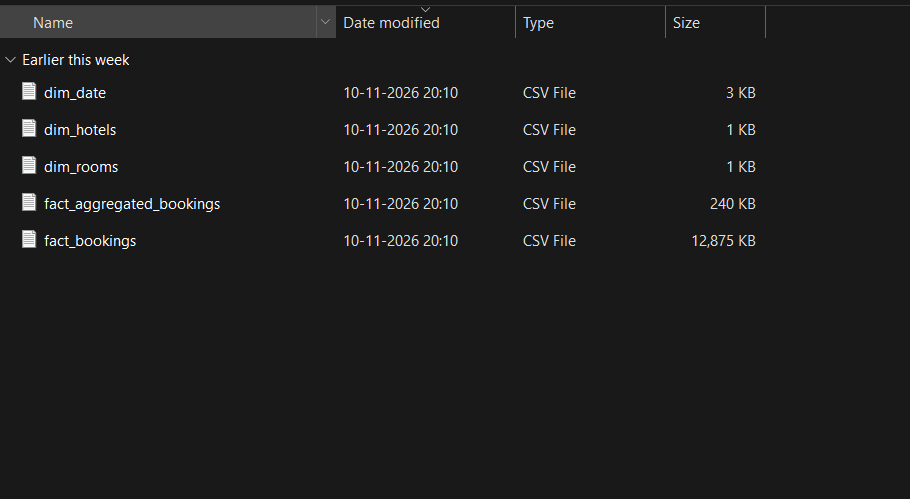

#### Evaluation of Revenue in the Hospitality Sector

##### Description of the Project

* This project will analyze hotel income and its individual bookings (performance) on Microsoft Power BI.
* The dashboard creates the image of income fluctuations, of occupancy statistics, of booked rooms (trends) and of cancellation rates, which can help the hotel management.

##### Business Problem

The hotel administration should make efforts to learn how revenue works, how guests behave while booking, what occupancy looks like and how cancellations affect revenue generation in this sphere.

##### Goals of the Project

##### 

* Study hotel revenue as a whole.
* Use KPI’s of hospitality.
* Learn the trends of hotel occupancy.
* Analyze the booking patterns.
* Find the trends of cancellations.
* Provide business data.

##### Tools to be Used

* Microsoft Power BI
* Power Query
* DAX
* Dataset CSV

##### Dataset Description

###### The project is based on the following dataset files:

###### 

1. dim\_date.csv
2. dim\_hotels.csv
3. dim\_rooms.csv
4. fact\_aggregated\_bookings.csv
5. fact\_bookings.csv

The dataset files were obtained from the YouTube tutorial for learning purposes and for project development.

##### Data Cleaning \& Preparation

* Checked the data types.
* Addressed the missing values wherever it was necessary.
* Deleted the duplicate entries wherever it was required.
* Processed the data using Power Query.
* Established the relationships between the tables.

##### Dashboard Features

* Revenue Analysis
* Occupancy Analysis
* Booking Analysis
* Cancellation Analysis
* Key Performance Indicators (KPIs)

##### Key Findings

###### The dashboard provides information on:

* Revenue performance and trends.
* Occupancy trends.
* Booking behavior.
* Cancellation trends.
* Opportunities for business improvements.

##### Project Files

Dataset: Contains CSV files.

Screenshots: Contains screenshots of dashboard and analysis.

Hospitality\_Dashboard.pbix: The Power BI dashboard file.

##### Conclusion

This project proves the importance of Power BI, Power Query, and DAX in transforming the hospitality data into useful business insights and making data-driven 

## 📊 Project Screenshots

### 1. Final Dashboard

### 2. Data Model View

### 3. DAX Measures

### 4. Data Transformation

### 5. Dataset Overview
shot/01_dataset.png)decisions.

